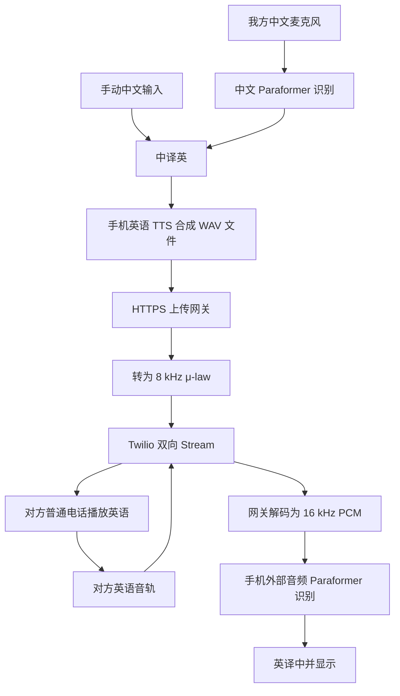

# 电话翻译实现说明（0.3.0）

用户已选择电话网关。当前实现由应用发起通话，Twilio 呼叫对方普通号码；默认开放孟加拉国 +880 和马来西亚 +60。网关实现包含真实 Twilio 适配器及独立模拟模式，真实通话尚待开通账号和部署后的验收。

## 声音路径

中文原声只有一条去往中文识别服务的路径。手机网关 WebSocket 只允许文本控制消息，拒绝原始二进制上传；发送音频接口接收的是 `synthesizeToFile` 生成的 WAV。服务端再转换并向 Twilio 发送无 WAV 头的原始 μ-law；没有从手机麦克风到电话发送音轨的连接，也不会在本机调用 `tts.speak`。

对方来音属于 Twilio 的 inbound track。中文麦克风识别与远端英语识别是独立任务，后者不创建 AudioRecord。英译中在单独工作队列执行，发送英语期间继续接收对方声音。未调用聊天大模型，不会自动回答对方问题。

## 拨号及生命周期

REST 创建仅预留会话，不立即外呼。手机附着网关 WebSocket 后先准备远端识别和英语 TTS；两者就绪才发送一次拨号控制消息。Twilio `<Connect><Stream>` 建立后，界面才能发送。预留 30 秒内未附着/完成准备会清理；不会自动重新拨号。

每句译文有唯一 UUID。服务端拒绝重复 UUID 和尚有待播放音频时的新上传。发送成功的 HTTP 响应只代表已接受；Twilio 返回对应 mark 后才展示线路完成播放。确认超时或上传结果不确定会请求挂断，不自动重播。模拟模式的确认始终标注 simulated，并明确提示没有真实远端播放。

手机断开后服务器请求结束呼叫。供应商挂断失败保留 ending 状态并重试；创建呼叫超时且 Call SID 不明时，也保留不确定状态，等待签名回调恢复 SID 后挂断。真实请求设置供应商 TimeLimit，默认最长 30 分钟。当前单用户内存版本只能运行一个 worker，重启不能恢复会话。

## 输入和话术

手动中文先点击发送，随后自动翻译、合成和发送。这样编辑、粘贴和修改话术时不会意外将半句话传入电话。中文语音输入以完成的句子为单位自动发送，最多排队 10 句；失败会关闭语音输入，可重新填入失败句重试。

话术区支持每行一条、加密保存、点选填入和复制；不自动发送。关闭中文语音输入时尚未完成的识别句子不发送。对方语言目前固定英语；其他语言需同时扩展识别、翻译和合成配置。

## 验证

主机测试覆盖网关鉴权、国家区号、RPC 签名、识别协议、G.711 向量、WAV 转换、双向音频和播放 mark、回调和会话校验、挂断重试及超时清理。Twilio API 使用测试替身，没有创建付费电话。

账号、服务器和手机就绪后的真实验收步骤见 [电话网关配置指南](电话网关配置指南.md)。当前还不能把模拟测试结果视为真实国际电话已验证。